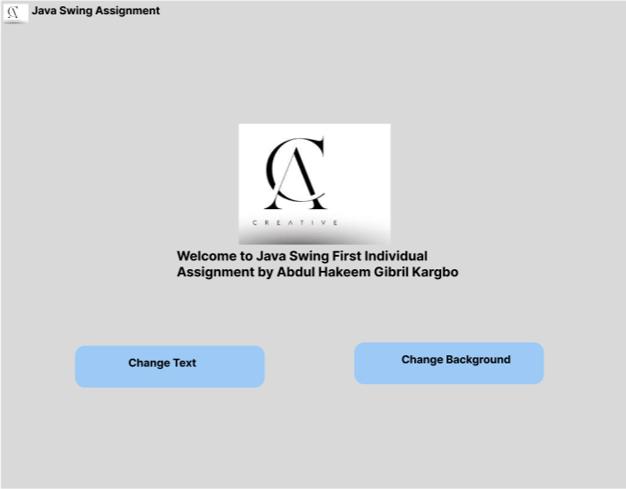

# Java Swing Assignment

**Module:** PROG209 Event Driven Programming
**Assignment:** Basic Interactive GUI (Individual)
**Student:** Abdul Hakeem G Gibril Kargbo
**Examiner:** Amandus Benjamin Coker


## Introduction

A basic GUI application built with Java Swing. It shows a window with a welcome message and lets the user change the label text and the panel background color. It demonstrates `JFrame`, `JPanel`, `JLabel`, `ImageIcon`, inheritance and constructors.

## Features

- `JFrame` titled "Java Swing Assignment", 800x800, closes the application on exit
- `JPanel` holding the label
- `JLabel` with the welcome message and my name
- Custom application icon loaded with `ImageIcon`
- Functionality to change the label text and the panel background

## Repository Files

| File | Description |
|---|---|
| `JavaSwingAssignment.java` | Source code |
| `figmaJava00.png` | Figma wireframe |
| `images.jpg` | Application icon |
| `Java_Swing_Individual_Assignment_Documentation` | Assignment documentation |

## Concepts Used

- **Inheritance:** the class extends `JFrame`
- **Constructor:** the constructor builds and configures the GUI components
- **Event handling:** `ActionListener` responds to user actions

## Wireframe



## How to Run

1. Clone the repository:
   ```
   git clone https://github.com/keem7/Java-swing-assignment.git
   ```
2. Open it in IntelliJ IDEA or VS Code (JDK 8+).
3. Keep `images.jpg` in the same folder as the Java file.
4. Run `JavaSwingAssignment.java`.

## Author
Abdul Hakeem Gibril Kargbo 
